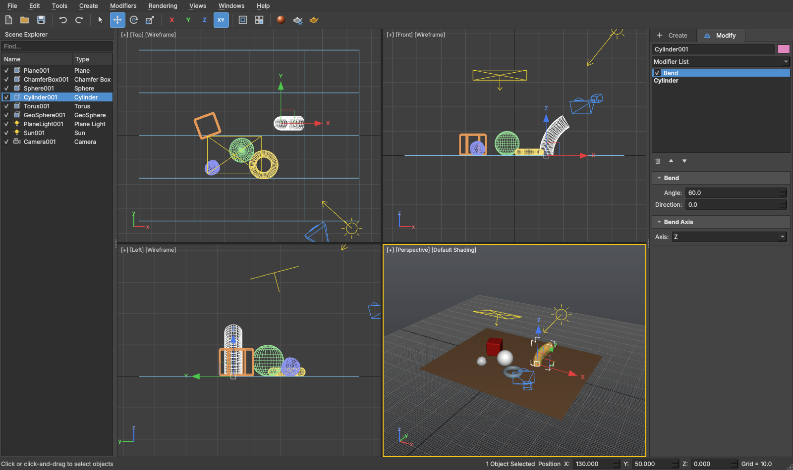
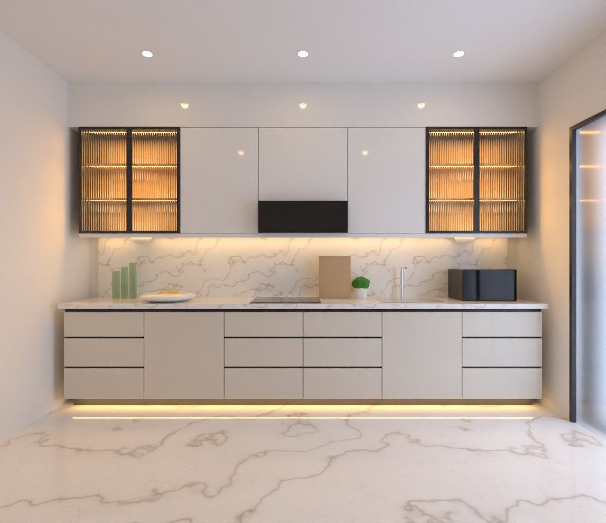
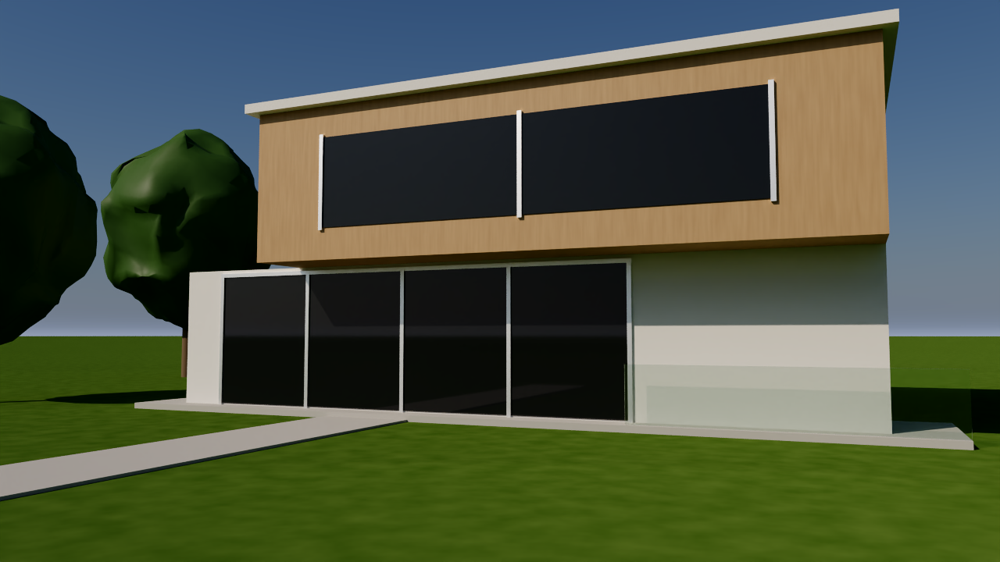
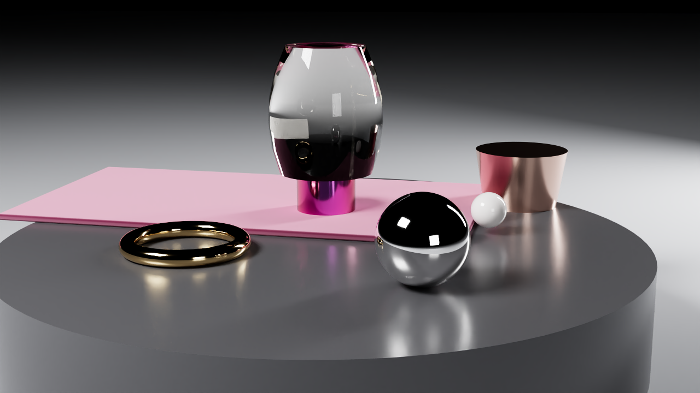
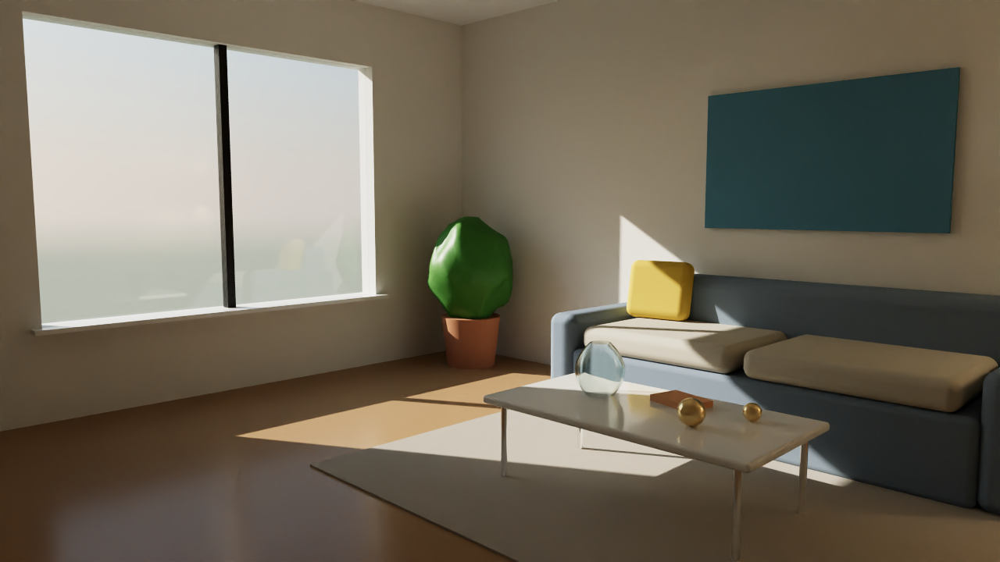

# Veraa

Veraa is a free, open-source 3D modeling and photorealistic rendering application for
Windows and Linux. It is built from scratch in C++ and follows the workflow that users of
Autodesk 3ds Max and Chaos V-Ray know: four viewports, a command panel with a modifier
stack, a material editor with rendered previews, and a progressive path-traced frame buffer.

Veraa is an independent project. It contains no code from 3ds Max or V-Ray and is not
affiliated with Autodesk or Chaos.



## Download (Windows)

The ready-to-run Windows app is in the [`App`](App) folder of this repository: `Veraa.exe`
with everything it needs next to it. No installation is needed.

1. On the repository page, click **Code > Download ZIP** (or clone the repository).
2. Unzip it anywhere.
3. Open the `App` folder and double-click `Veraa.exe`.

The `App` folder is rebuilt automatically after every change, so downloading the repository
again always gets the newest version.

Requirements: 64-bit Windows 10 or 11, a graphics driver with OpenGL 3.3, and a CPU with
SSE4.2 or newer (any PC from the last decade). Rendering runs on all CPU cores; no GPU is
needed.

## What's inside

### Modeling

- **Primitives:** Box, Sphere, GeoSphere, Cylinder, Cone, Tube, Torus, Pyramid, Plane,
  Chamfer Box, all with segment and smoothing parameters.
- **Interactive creation** like 3ds Max: drag the footprint, move the mouse for the height.
- **Modifier stack:** Bend, Taper, Twist, Noise (fractal), Smooth (Catmull-Clark
  subdivision), Shell, Push, UVW Map (planar, cylindrical, spherical, box), Mirror,
  Normal. Enable, reorder and delete modifiers; edit parameters live.
- **Smoothing groups**, polygon (n-gon) meshes, Convert to Editable Poly.
- **OBJ import** with MTL materials and textures.

### Scene

- **Lights:** Plane (area) light, Sphere light, Omni, Spot, Sun, all with soft shadows.
- **Environment:** flat color, sky gradient, HDRI image (with importance sampling) or a
  physical sky driven by the Sun light: a spectral atmosphere with multiple scattering and
  ozone (valid through sunset and twilight), the Hosek-Wilkie 2012 sky, or Preetham. Sun and
  sky are in real units (a sunny day is right at EV 15) and the sun disk has limb darkening.
- **Cameras** with field of view and depth of field; create a camera from any view.
- **Scene Explorer**, select by name, hide/unhide, clone with copies, object properties.
- Unlimited **undo/redo**.

### Materials (V-Ray style)

Diffuse color and map, reflection with glossiness, Fresnel and metalness, refraction with
IOR, fog (colored absorption) and thin-walled mode, self-illumination, opacity, bump maps
and tiling. Metals can use measured complex IORs (gold, silver, copper, aluminium, chromium,
iron, titanium, nickel, cobalt, brass), reflections and coats can carry a thin-film
interference layer (soap, oil, anodized titanium), sheen follows Estevez-Kulla, and rough
GGX reflection and refraction are energy-compensated for multiple scattering. The material
editor renders a sample sphere for each material and ships with presets such as glass,
measured metals, high-gloss lacquer, thin-film and velvet.

### Rendering

- Unbiased **path tracing** with global illumination, next-event estimation and multiple
  importance sampling, built on Intel Embree.
- **Progressive** rendering in the frame window: the image refines while you watch, with
  live exposure and color mapping (Filmic ACES, AgX-style filmic view, Reinhard with burn,
  Linear, Exponential, HSV/Intensity exponential, Gamma; dark/bright multipliers, affect
  background, adaptation only), contrast and saturation. Look presets: Interior (archviz),
  Exterior daylight, Product studio.
- **Denoiser:** Intel Open Image Denoise turns a few seconds of noise into a clean image.
- Depth of field, sunlight through glass, caustics-free glass via shadow transparency,
  clamping for firefly control, time or sample limits.
- Save renders as PNG, JPG, BMP or HDR.
- **Command-line renderer:** `veraa-render scene.veraa -o image.png --width 1920 --height 1080 --samples 256`

| Kitchen (IES downlights, LED strips, frosted daylight) | Exterior under the physical sky |
|---|---|
|  |  |
| **Studio product shot (measured metals, thin film, sheen)** | **Interior with sun and physical sky** |
|  |  |

Sample scenes are in the `scenes` folder (made by `scenes/generate_scenes.py`): `kitchen.veraa`,
`exterior_daylight.veraa`, `studio_product.veraa`, `living_room.veraa`, `product_shot.veraa`,
`cornell_box.veraa`.

## Keyboard shortcuts

| Keys | Action |
|---|---|
| Q / W / E / R | Select / Move / Rotate / Scale |
| F5 / F6 / F7 / F8 | Constrain to X / Y / Z / plane |
| H | Select by name |
| Ctrl+A / Ctrl+D / Ctrl+I | Select all / none / invert |
| Ctrl+V | Clone |
| Delete | Delete selection |
| Ctrl+Z / Ctrl+Y | Undo / Redo |
| Z / Ctrl+Shift+Z | Zoom extents selected / all |
| Alt+W | Maximize viewport |
| T / B / F / L / P / U | Top / Bottom / Front / Left / Perspective / Orthographic |
| C / Ctrl+C | Camera view / Create camera from view |
| F3 / F4 | Wireframe / Edged faces |
| G | Toggle grid |
| M | Material Editor |
| F10 | Render Setup |
| Shift+Q or F9 | Render |
| Middle mouse | Pan (Alt: orbit, Ctrl+Alt: zoom); wheel zooms toward the cursor |

Press F1 in the app for the full list.

## Building from source

Requirements: CMake 3.21+, a C++17 compiler (Visual Studio 2022 or GCC 11+), Qt 6.4+,
Intel Embree 4, and optionally Intel Open Image Denoise 2.

Linux (Ubuntu 24.04):

```bash
sudo apt install cmake ninja-build qt6-base-dev libembree-dev libgl-dev
cmake -S . -B build -G Ninja -DCMAKE_BUILD_TYPE=Release
cmake --build build
ctest --test-dir build
./build/bin/Veraa
```

Windows: install Qt 6 (MSVC 2022, 64-bit) and download the prebuilt
[Embree](https://github.com/RenderKit/embree/releases) and
[Open Image Denoise](https://github.com/RenderKit/oidn/releases) packages, then:

```powershell
cmake -S . -B build -G "Visual Studio 17 2022" -A x64 `
  -Dembree_DIR=C:\embree\lib\cmake\embree-4.3.3 `
  -DOpenImageDenoise_DIR=C:\oidn\lib\cmake\OpenImageDenoise-2.3.3
cmake --build build --config Release
```

`.github/workflows/build.yml` shows the exact steps the Windows package is built with.

## Project layout

| Folder | Contents |
|---|---|
| `src/core` | Scene, primitives, modifiers, materials, `.veraa` files, OBJ import (no UI) |
| `src/render` | The path tracer, lights, materials, environment, denoiser, image output |
| `src/cli` | `veraa-render` command-line renderer |
| `src/app` | The Qt desktop application |
| `tests` | Core and renderer tests |
| `scenes`, `assets` | Sample scenes and the sample HDRI |

## License

Veraa is released under the [MIT License](LICENSE). It uses Qt (LGPL v3), Intel Embree,
Intel Open Image Denoise and other open-source components listed in
[THIRD_PARTY_NOTICES.md](THIRD_PARTY_NOTICES.md).
